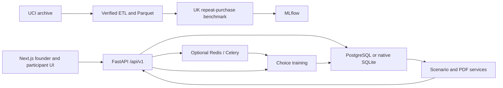

# Technical specification

## Runtime

The browser uses Next.js and proxies versioned REST requests to FastAPI. The API enforces project ownership at lookup time. SQLAlchemy models and a frozen Alembic migration support SQLite and PostgreSQL. The API inserts a model run before dispatch, and the worker claims queued rows with a database lock. Native mode runs the same training routine synchronously. Artifacts and results are persisted as JSON. The data pipeline and research evaluation are separate command-line entry points.

## Domain boundaries

A user owns projects and can grant registered accounts editor access. Membership is checked for both resource lookups and list queries. Only owners manage members and delete projects. A project owns concepts, variants and studies. Study designs and allocation limits are snapshots fixed at creation. Random studies receive a persisted subset and display order. Balanced and adaptive studies append tasks one at a time using an integer assignment version to prevent competing browser reloads from appending duplicate tasks. A unique key on participant plus task prevents contradictory duplicate choices. Outside option index zero is invariant under ordering. The participant authorization secret is stored as a hash and does not identify the participant across studies. Training joins response rows back to the exact assigned design and order.

Model runs, simulations and reports retain project ownership. Cascading foreign keys remove child records after project deletion. Real-study withdrawal deletes the participant, associated responses, models and derived scenario records in the database. The exported file lifecycle is managed under the approved study protocol.

## Security and deployment

Argon2id hashes protect passwords. HTTP-only, strict SameSite cookies hold short-lived access and rotating refresh credentials. Founders may register directly. Researcher registration requires the configured enrollment code. Real study creation and launch require an approved protocol configured in the backend. State-changing routes reject cross-site browser requests. Configure TLS and secure cookies for shared deployments. The included per-process auth limit is for local use. A shared deployment should provision an edge rate limiter, backup policy and a worker recovery strategy.

OpenAPI at `/docs` describes the implemented routes. Dataset source documentation and result files are versioned independently of raw data and model binaries.

Each training attempt has a claim identifier. Retry clears the claim only for a failed run or an interrupted run older than 20 minutes. A stale attempt cannot overwrite a replacement attempt. Celery acknowledges after execution and rejects work on worker loss. Redis uses append-only persistence and a named data volume. The native path executes the same trainer synchronously. Study and model notifications are database records, and access is removed with project membership.

Images are decoded and re-encoded as PNG before database storage. Raw uploads over 5 MB and decoded images over 16 megapixels are rejected. Database backups therefore include uploaded packaging images. The native launcher runs startup checks, applies migrations and rebuilds the frontend when needed.
